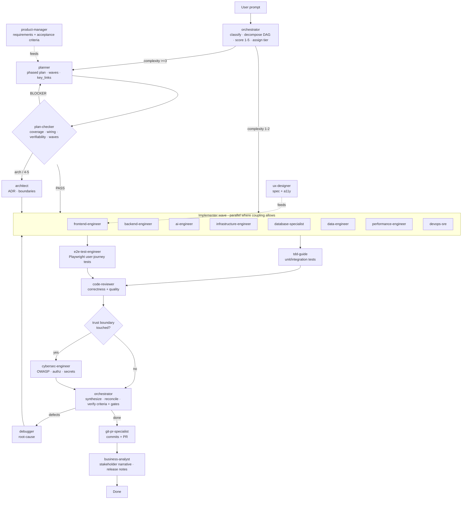

# Orchestration

How the squad turns a prompt into shipped, reviewed work.

## One-liner

`User prompt → orchestrator (open task file + clarify-intent if ambiguous or ≥3 + decompose into waves + score 1–5 + assign tier) → planner (if ≥3) → plan-checker (gate) → specialists (parallel by wave) → tests → code-reviewer → cybersec-engineer (if trust boundary) → orchestrator (synthesize, verify goal-backward: criteria + gates + must_haves)`

All agents hand off through a single **task file** (`workflow/README.md`). It carries `status`,
`owner`, `complexity`, `completed_steps`, `pending_steps`, `acceptance_criteria`, `must_haves`
(truths/artifacts/key_links), `wave`/`depends_on`, `gates`, and `blockers` — so nobody forgets
prior work or duplicates a step. No agent marks `DONE` until every acceptance criterion **and**
every blocking gate is verified **goal-backward** against `must_haves`. For ≥3 tasks, `plan-checker`
gates the plan before any implementer starts.

> **Planning vs runtime.** "Parallel by wave" is the *intended execution order*, not a promise the
> host runs agents concurrently on its own. If the host grants the orchestrator a subagent-dispatch
> capability, it dispatches each wave; otherwise the orchestrator emits the routing plan + task file
> and the host session (human or outer loop) invokes agents in wave order. The task file +
> `.ai-workflow/progress.md` ledger are what make this resumable regardless of who drives.

## Flow

> The diagram shows the primary flow. Invoked **per need** (see roles table): `context-manager`
> (long sessions), `database-specialist` / `data-engineer` / `performance-engineer` / `devops-sre`
> (in the implementer wave when relevant), `technical-writer` (docs), and `squad-optimizer`
> (improves the squad after the run). `clarify-intent` runs before decomposition when ambiguous.

## Roles at a glance

| Agent | Tier | Writes code? | Fires when |
|-------|------|--------------|-----------|
| orchestrator | high-reasoning | no | first, every non-trivial request |
| planner | high-reasoning | no | complexity ≥3 |
| plan-checker | high-reasoning | no | gate a ≥3 plan before execution |
| architect | high-reasoning | no | new system / cross-cutting / 4–5 |
| context-manager | balanced | no | long sessions, handoff, context near limit |
| frontend-engineer | balanced | yes | UI layer |
| backend-engineer | balanced | yes | server / API |
| ai-engineer | high-reasoning | yes | LLM/AI code, token/cache work |
| ai-researcher | high-reasoning | no (reports) | technique/paper scouting, eval & experiment design, ablations, benchmark/model selection |
| cybersec-engineer | high-reasoning | no (reports) | auth/input/deps/secrets |
| infrastructure-engineer | balanced | yes | IaC provisioning |
| database-specialist | high-reasoning | yes | schema, queries, indexes, migrations |
| data-engineer | high-reasoning | yes | ETL/ELT, pipelines, data contracts |
| performance-engineer | high-reasoning | yes | profiling, optimization (measured) |
| devops-sre | balanced | yes | CI/CD, deploy, alerting, incidents |
| code-reviewer | balanced | no (reports) | after implementation, pre-PR |
| tdd-guide | balanced | yes (tests) | unit/integration coverage, TDD |
| e2e-test-engineer | balanced | yes (tests) | browser E2E behavior, user journeys |
| debugger | high-reasoning | no (diagnoses) | a failure: failing test, trace, prod error |
| git-pr-specialist | balanced | yes (git) | commits, PR descriptions, branch splitting |
| technical-writer | balanced | docs | docs, API reference, changelogs |
| ux-designer | balanced | specs/copy | UI design + a11y |
| product-manager | balanced | docs | underspecified / acceptance criteria |
| business-analyst | balanced | docs | stakeholder / release comms |
| business-strategist | high-reasoning | docs | business plan, pricing/monetization, GTM, market sizing, unit economics |
| ai-platform-strategist | high-reasoning | dossiers | per-domain AI strategy (DDD + Langfuse + ROI) |
| squad-optimizer | high-reasoning | yes (meta) | gaps/corrections — improves the squad itself |
| tool-learner | high-reasoning | yes (cards) | a tool needs a knowledge card / version refresh |
| squad-customizer | high-reasoning | yes (gen) | generate a per-customer squad from wizard answers |

## Skills agents invoke

Skills are reusable procedures (the *how*); agents load them on demand. Each agent lists the
skills it uses in its own `## Skills` section.

| Skill | Invoked by |
|-------|-----------|
| `brainstorming` · `clarify-intent` · `decision-mapping` | orchestrator, planner |
| `grilling` | orchestrator, planner, architect |
| `deep-modules` | architect, backend-engineer, frontend-engineer, code-reviewer |
| `architecture-audit` | architect, performance-engineer |
| `to-spec` | product-manager, planner |
| `to-tickets` | product-manager, planner |
| `repo-guardrails` | devops-sre, git-pr-specialist |
| `human-step-wizard` | infrastructure-engineer, devops-sre |
| `domain-modeling` | architect, planner |
| `prototype` | frontend, backend, architect |
| `triage` | orchestrator, planner |
| `resolving-merge-conflicts` | git-pr-specialist |
| `handoff` | context-manager, any agent ending a session mid-work |
| `write-adr` | architect |
| `clean-code` · `solid-dry` · `design-patterns` | frontend, backend, ai-engineer, code-reviewer |
| `convention-over-configuration` | frontend, backend, architect, code-reviewer |
| `diagram-generator` | architect, ai-platform-strategist, squad-customizer |
| `secure-regex` | backend, cybersec-engineer, code-reviewer, data-engineer |
| `simplest-solution` | every agent writing code, code-reviewer |
| `design-audit` | frontend, code-reviewer |
| `video-understanding` | any agent handed footage |
| `notebooklm-research` | ai-engineer, planner |
| `obsidian-notes` | any agent managing notes |
| `behavior-driven-testing` | tdd-guide, e2e-test-engineer, code-reviewer |
| `conventional-commits` · `pr-description` · `git-worktree-isolation` | git-pr-specialist |
| `code-review-checklist` · `traceability-matrix` · `receiving-code-review` | code-reviewer |
| `root-cause-analysis` · `debugging-method` · `root-cause-tracing` · `defense-in-depth` · `condition-based-waiting` | debugger, devops-sre |
| `observability-standards` | backend, devops-sre, data-engineer |
| `threat-modeling` | cybersec-engineer |
| `dependency-upgrade` | backend, infrastructure-engineer |
| `ai-cost-optimization` · `rag-design` · `grounded-generation` · `fine-tuning-strategy` | ai-platform-strategist, ai-engineer |
| `knowledge-graph` *(purchased add-on)* | architect, data-engineer, ai-platform-strategist |
| `apify` | data-engineer, backend |
| `performance-profiling` | performance-engineer |
| `subagent-driven-development` | orchestrator, planner |
| `prompt-injection-defense` | cybersec-engineer, every agent handling external input |
| `writing-skills` | squad-optimizer |

## Human-in-the-loop gates

- After `planner` produces a plan (before implementation).
- After `architect` ADR on complexity 4–5.
- After `code-reviewer` / `cybersec-engineer` flag critical issues.
- Before any irreversible/outward action (deploy, push, send).

## State handoff (the task file)

Handoff runs through the task file (`workflow/README.md`, `templates/task-file.md`) — the
portable state machine: `PLANNING → READY → IN_PROGRESS → BLOCKED ⇄ → DONE`. `orchestrator`
sets `owner` before each dispatch; an agent skips a step already in `completed_steps`, and only
sets `DONE` when all `acceptance_criteria` **and** every blocking gate are verified (else
`BLOCKED` with a reason). This makes multi-step runs resumable and stops duplicated/forgotten
work — with no vendor hooks.

`context-manager` keeps the task file and `project-context.md` compact on long sessions;
`squad-optimizer` reads `LESSONS.md` + interaction gaps to improve the squad over time.

### Cross-tool memory ledger

Alongside the task file (hard state) sits the **memory ledger** (`templates/memory-ledger.md` →
`.ai-workflow/memory.md`): the *soft* in-flight history — decisions made, dead-ends ruled out,
progress notes — distilled, newest-first, and bounded. An agent **reads memory on entry** and
**records decisions/progress on exit**, so switching AI tools (Claude Code ⇄ Cursor) mid-task loses
no context. The ledger is repo-resident (travels with the repo even without a server) and, when the
Integralis MCP server is connected, is synced through the free `record_memory` / `read_memory` tools.

## Self-improvement loop

`squad-optimizer` closes the loop: after an interaction reveals a gap (repeated correction,
unfit request, painful task), it edits the right canonical source (agent/skill/template/hook),
runs `sync-adapters.sh` + `eval.sh`, and records the change in `LESSONS.md`. Large changes
(adding/removing an agent) are confirmed with the user first.

## Token efficiency

The shared **Guardrails** + **Working agreement** blocks are byte-identical across all agents —
a stable cache prefix. Combine with `ai-engineer`'s Headroom setup (`docs/headroom-setup.md`)
to cut cost on long runs.
